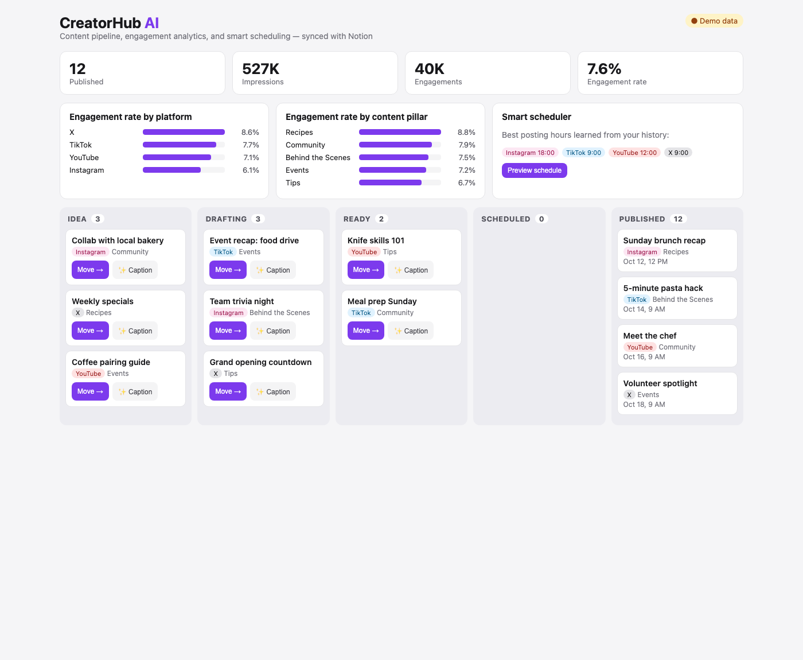

# CreatorHub AI


A content operations dashboard for social media teams. It syncs with a **Notion** content database and adds what Notion lacks: an engagement analytics view, a **data-driven auto-scheduler** that learns each platform's best posting hour from past performance, and **AI caption suggestions**.



## Features

- **Notion integration** – reads and writes a Notion database through the Notion REST API (cursor pagination, property mapping); the integration token stays server-side and never reaches the browser
- **Pipeline board** – Idea → Drafting → Ready → Scheduled → Published, with status changes written back to Notion
- **Engagement analytics** – impressions, engagements, and engagement rate overall, by platform, and by content pillar; top-performing posts
- **Smart scheduler** – learns the best publishing hour per platform from historical engagement rate, then fills a 2-week calendar with "Ready" posts. Rules: no slots in the past, at most one post per platform per day, at most 2 posts per day. You can preview the plan before applying it.
- **AI captions** – generates a caption modeled on the best-performing post in the same pillar (OpenAI when `OPENAI_API_KEY` is set, template fallback otherwise) and enforces each platform's character limit
- **Demo mode** – runs on sample data with zero setup

## Tech Stack

| Layer | Technology |
|---|---|
| Frontend | React 18 (function components and hooks; `htm` templates, no build step), CSS grid |
| Backend | Python 3 standard library REST API (`http.server`) |
| Integrations | Notion API v1, OpenAI Chat Completions (optional) |
| Quality | `unittest` (analytics, scheduler rules, Notion mapping and pagination with mocked HTTP), GitHub Actions CI |

## Quick Start

```bash
git clone https://github.com/okrahgadiel/creatorhub-ai.git
cd creatorhub-ai
python -m creatorhub          # http://127.0.0.1:8000 (demo data)
```

### Connect Your Notion Workspace

1. Create an internal integration at notion.so/my-integrations and copy its token.
2. Create a database with these properties: **Name** (title), **Platform** (select), **Pillar** (select), **Status** (status), **Publish Date** (date), **Impressions / Likes / Comments / Shares** (number), **Caption** (text).
3. Share the database with your integration, then run:

```bash
export NOTION_TOKEN="secret_..."
export NOTION_DATABASE_ID="<32-char id from the database URL>"
python -m creatorhub
```

Property names can be changed in `creatorhub/notion.py` (`PROPS`).

## API

| Method | Path | Purpose |
|---|---|---|
| GET | `/api/posts` | All posts (Notion or demo store) |
| GET | `/api/analytics` | Totals, breakdowns, top posts, best hours, pipeline counts |
| POST | `/api/schedule` | `{"apply": false}` previews, `{"apply": true}` writes the schedule back |
| POST | `/api/posts/<id>` | Update status, publish date, or caption (validated) |
| POST | `/api/suggest/<id>` | AI caption suggestion |

## Project Structure

```
creatorhub/
  notion.py     Notion client (query + update, pagination) and JSON demo store
  insights.py   analytics, best-hour learning, auto-scheduler, caption suggestions
  server.py     REST API + static file server (path-traversal safe)
web/            React app (index.html, app.js, styles.css)
tests/          unit tests
```

```bash
python -m unittest discover -s tests -t . -v
```

## License

MIT
